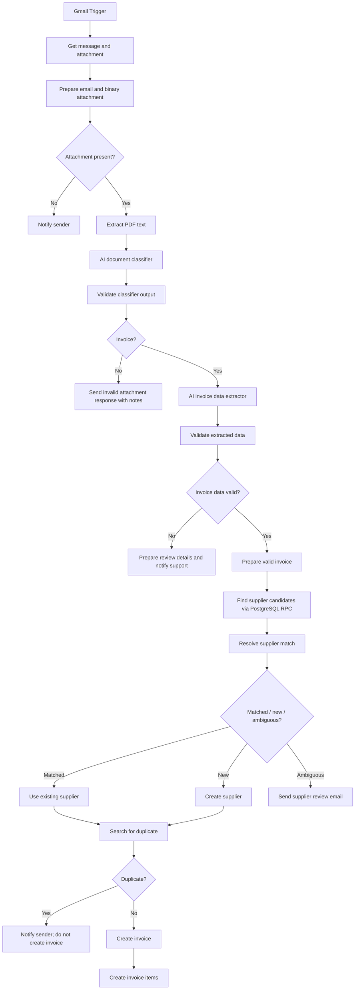

# AI Invoice Processing

An n8n workflow that receives invoice documents by email, classifies and extracts their contents, validates the resulting data, resolves the supplier, checks for duplicates, and stores accepted invoices and line items in PostgreSQL/Supabase.

> **Portfolio note:** This README describes the workflow architecture and behavior established during development. Exact deployment URLs, credential names, schema identifiers, and numeric supplier-match thresholds are intentionally omitted because they are environment-specific or were not confirmed in the project notes.

## Overview

The workflow automates the intake of emailed PDF invoices. It combines AI for document interpretation with deterministic checks and explicit business branches. When invoice data is invalid or a supplier match is ambiguous, it routes the case for human review rather than silently guessing. A separate n8n Error Workflow supports technical failure handling and remains separate from the invoice workflow's business logic.

## Business problem

Finance teams often receive invoices in inconsistent layouts and must manually identify the document, enter header and line-item data, verify totals, select a supplier record, and check whether the invoice was already recorded. The workflow reduces repetitive entry while preserving review points where confidence or data quality is insufficient.

## Workflow architecture



### Processing stages

1. **Email intake:** Gmail Trigger starts the workflow. A Gmail message retrieval step obtains the email and attachment; a preparation step preserves the PDF as binary data for file extraction.
2. **Attachment and classification:** The workflow checks for an attachment, extracts PDF text, and asks an AI classifier to return `file_type` (`INVOICE` or `NON-INVOICE`) plus `extraction_notes`. A code step validates the response shape before routing.
3. **Invoice extraction and validation:** A separate AI step extracts invoice data. A deterministic validation step checks the shape and business requirements before accepted data proceeds.
4. **Supplier resolution:** A PostgreSQL RPC using the `pg_trgm` similarity extension returns supplier candidates. Workflow logic classifies the result as matched, new, or ambiguous.
5. **Duplicate check and persistence:** The workflow searches for an existing invoice using supplier ID, invoice number, and invoice date. Only a non-duplicate proceeds to invoice and line-item creation.

## Key features

- Email-triggered processing of PDF attachments.
- Separate AI stages for document classification and invoice extraction.
- Structured output validation before workflow routing.
- Business validation with a human-review path for invalid or incomplete data.
- Supplier matching with candidate scores, new-supplier handling, and an ambiguity review branch.
- Duplicate detection before persistence.
- Separate invoice-header and invoice-line-item records.
- Sender/support notifications for selected business outcomes.

## AI and deterministic responsibilities

| Component | Responsibility |
|---|---|
| Document classifier (AI) | Interpret extracted PDF text and classify it as an invoice or non-invoice; provide explanatory extraction notes. |
| Invoice extractor (AI) | Interpret document text and extract the defined invoice fields and line items. It must not invent missing values or alter amounts to force a balance. |
| Structured output parser | Require the configured response structure and field types. |
| Code and conditional nodes | Validate response structure and business data, calculate supported checks, and control routing. |
| PostgreSQL/Supabase | Search supplier records, perform similarity matching through the configured RPC, check for duplicate invoices, and persist accepted records. |
| Human reviewer | Resolve invalid data or supplier ambiguity that the workflow cannot safely decide. |

The guiding rule is: **AI interprets; deterministic logic validates and routes.** The classifier decides what a document appears to be, while code validates that the classifier returned a usable, allowed result.

## Document classification

The classifier receives text extracted from the PDF and returns:

```json
{
  "file_type": "INVOICE",
  "extraction_notes": ["This is an invoice."]
}
```

It considers overall invoice context rather than requiring every possible field to appear. Missing a due date, tax, subtotal, or customer information by itself does not make a document a non-invoice. The downstream extractor and validator handle missing data. Non-invoices and unusable classifier output follow separate handling paths.

## Invoice extraction fields

The extraction structure includes:

- `invoice_number`
- `supplier_name`
- `invoice_date`
- `due_date`
- `currency`
- `subtotal`
- `tax`
- `withholding_tax`
- `total`
- `line_items[]`: `description`, `quantity`, `unit_price`, and `amount`
- `extraction_notes[]`

Fields that may be absent are represented as `null` where appropriate so that extraction can complete and deterministic validation can route the invoice for review. The extractor distinguishes the supplier/issuer from the client or bill-to party. Withholding tax is represented separately from sales tax; it is not encoded as negative tax. Currency defaults and date interpretation follow the configured extraction instructions and should be reviewed against the deployed prompt before reuse.

## Validation rules

Validation is intentionally scoped to the invoice model supported by this project. It checks required information, types and numeric values, line-item structure, and supported total arithmetic. The configured arithmetic rule is:

```text
subtotal + tax - withholding_tax = total
```

The comparison uses a small rounding tolerance (the development logic used `0.01`). For example, `62,375 + 0 - 1,247.50 = 61,127.50` balances, while `30,000 + 3,000 - 0` does not equal `35,000` and should be routed for review. This is not a general accounting engine: invoices with additional discounts, fees, multiple taxes, or other unexplained components may require human review rather than assumptions.

The structured parser checks whether AI output conforms to the expected schema; it does not determine whether the invoice is valid. The deterministic validator owns that decision.

## Supplier resolution

Supplier candidates are retrieved through a PostgreSQL RPC backed by the `pg_trgm` extension. The workflow uses candidate similarity scores and configured decision thresholds to distinguish:

- **Matched:** use the existing supplier record.
- **New:** create a supplier record, then use its returned ID.
- **Ambiguous:** send a review email with the extracted supplier name, invoice context, candidate names, and similarity scores. Do not create a supplier or invoice on this branch.

The exact RPC identifier and threshold values are deployment configuration and are not stated here. Keep the thresholds explicit in the RPC/workflow configuration, test them against representative supplier names, and avoid treating a borderline result as a certain match.

## Duplicate detection

Before insertion, the workflow searches for an existing invoice using the combined business key:

```text
supplier_id + invoice_number + invoice_date
```

If a duplicate is found, the workflow sends a notification and does not create another invoice. If none is found, it creates the invoice header and then the associated line items.

## PostgreSQL / Supabase schema summary

The workflow uses three logical tables:

| Table | Purpose | Key relationship |
|---|---|---|
| `suppliers` | Existing and newly identified supplier records. | Referenced by invoices through supplier ID. |
| `invoices` | Invoice-level details such as number, dates, currency, totals, and supplier reference. | Belongs to a supplier; checked for duplicates before insert. |
| `invoice_items` | Individual invoice line items, including description, quantity, unit price, and amount. | References the created invoice. |

This is a logical summary, not a migration specification. Exact column names, constraints, indexes, foreign-key behavior, and RPC signature must be taken from the deployed Supabase schema.

## Business exceptions and technical failures

| Scenario | Workflow handling |
|---|---|
| Email has no attachment | Send the configured no-attachment response. |
| Attachment is not an invoice | Send an invalid-attachment response, including classifier notes when available. |
| Classifier or extraction output is malformed | Reject the unusable result from normal processing and route according to the configured validation/error branch. |
| Invoice data fails validation | Send a support/review notification; do not proceed to supplier resolution or persistence. |
| Supplier is ambiguous | Send candidate details for human review; do not guess or create records on this path. |
| Supplier is new | Create a supplier, then continue with its resulting ID. |
| Invoice is a duplicate | Notify and skip invoice creation. |
| OpenAI, PostgreSQL/Supabase, PDF processing, or email service fails technically | A separate n8n Error Workflow is configured as the supporting technical-failure mechanism. It is not part of the invoice workflow's business logic. |

Business outcomes such as invalid invoices, ambiguous suppliers, and duplicates are handled inside the invoice workflow. Unexpected technical failures belong to the separate Error Workflow. The Error Workflow was created and assigned during development; its notification behavior should only be described as implemented if confirmed in the deployed version.

## Test cases and recorded results

The conversation records that the workflow was tested and specifically that the **ambiguous supplier branch was tested**. Detailed execution logs and a complete pass/fail matrix were not retained in the available project notes, so the table distinguishes recorded evidence from planned coverage.

| Case | Expected behavior | Recorded status |
|---|---|---|
| Valid text-based invoice | Classify, extract, validate, resolve supplier, check duplicate, and persist header/items if eligible. | End-to-end testing was reported; per-node result details are not recorded here. |
| Invalid total (`30,000 + 3,000 - 0 ≠ 35,000`) | Fail deterministic total validation and route to human review. | Test document and expected rule are documented; final execution result not recorded. |
| Non-invoice PDF | Classify as `NON-INVOICE`; send invalid-attachment response with notes. | Scenario defined; result not recorded. |
| Missing optional fields | Preserve null/notes as applicable; validate required fields and route if insufficient. | Scenario defined; result not recorded. |
| Ambiguous supplier | Present candidate suppliers and scores for review; do not create supplier/invoice. | Branch explicitly reported as tested; detailed execution output not recorded. |
| New supplier | Create supplier, obtain its ID, then continue to duplicate check and invoice persistence. | Identified as a branch to test; result not recorded. |
| Duplicate invoice | Notify and skip invoice creation. | Scenario defined; result not recorded. |
| No attachment | Take the no-attachment email branch. | Scenario defined; result not recorded. |
| Technical failure | Separate Error Workflow receives a failed execution and performs its configured handling. | Error Workflow was created/configured; completion of a final end-to-end error notification test is not established by the available notes. |

For a public portfolio, replace “result not recorded” with verified execution evidence (execution ID/date, observed branch, and database outcome) as those records become available. Do not claim every branch passed based only on the test plan.

## Setup and configuration

1. Import or recreate the workflow in an n8n instance with compatible Gmail, PDF extraction, AI, PostgreSQL/Supabase, and email nodes.
2. Configure Gmail credentials and the monitored mailbox. Confirm the trigger and message retrieval step return the original email and PDF binary data.
3. Configure the OpenAI model credentials, classifier prompt, invoice extraction prompt, and structured output schema.
4. In Supabase/PostgreSQL, create the `suppliers`, `invoices`, and `invoice_items` tables, enable `pg_trgm`, and provide the supplier-search RPC expected by the workflow. Set and document the similarity thresholds for matched, new, and ambiguous outcomes.
5. Configure database credentials, duplicate lookup fields, and insert mappings. Verify the supplier ID and invoice ID are carried through to related records.
6. Configure notification recipients and templates for no attachment, non-invoice, invalid invoice, ambiguous supplier, and duplicate outcomes.
7. Assign the separate technical Error Workflow in n8n workflow settings and verify it with a real event-triggered execution appropriate to the deployment.
8. Run the test cases with text-based PDFs and check both n8n execution data and resulting database rows.

Do not commit exported credentials, API keys, access tokens, private email addresses, or production invoice data. Use environment variables or n8n credentials and sanitized sample documents for demonstrations.

## Security and data handling

- Invoice PDFs and extracted text may contain personal, financial, or commercially sensitive information. Limit access to the mailbox, n8n instance, database, and execution logs.
- Send only the document data needed for classification and extraction to the AI provider, and review applicable retention and privacy settings for the deployment.
- Use least-privilege credentials for Gmail and database operations. Keep secrets in n8n's credential store or a managed secret store, never in workflow code or this README.
- Avoid logging full invoice contents or exposing extracted values in broad email notifications. Redact or minimize error details where practical.
- Define retention and deletion rules for source emails, binary attachments, execution data, and stored invoice records.
- Sanitize AI-provided text before embedding it in HTML email templates to prevent markup injection.

## Lessons and architecture principles

- Split classification from extraction so each AI step has a narrow purpose.
- Validate AI output before conditional routing; structured output is not proof of business correctness.
- Keep arithmetic and routing deterministic where the supported business rule is explicit.
- Represent withholding tax as a separate deduction instead of overloading sales tax.
- Stop for human review when supplier identity or invoice validity is uncertain.
- Resolve suppliers before duplicate checks because supplier ID is part of the duplicate key.
- Make database writes only after validation, supplier resolution, and duplicate detection.
- Keep technical failure handling separate from expected business exceptions.
- Scope the workflow to a clear invoice model instead of claiming support for every accounting convention.
